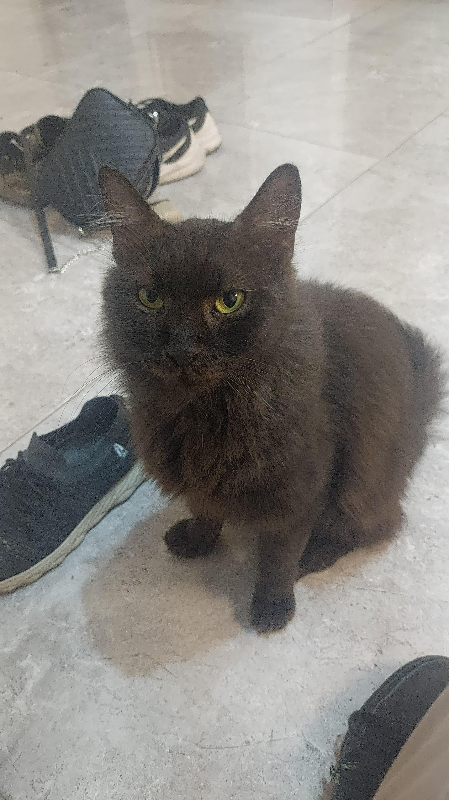

# Hello, I'm Michal! 🐱

Welcome to my Webpage!

## 🔬 About Me

I am currently an **M.S. student at the Weizmann Institute of Science** in the Jeffrey Gerst lab. I work with yeast to uncover the mechanisms behind targeting the mRNA of secreted and membrane proteins to the ER, using techniques such as smFISH and qPCR.

## 💖 Personal Interests

Balancing life in and out of the lab is important to me! When I am not conducting research, you can usually find me:

* 🐈 Spending time with my cats (my absolute favorite!).
* 📚 Reading a good book.
* 🎥 Watching a movie.
* 💪 Lifting weights at the gym.

One of my cats, Alex

---

*Thank you for visiting my page!*
